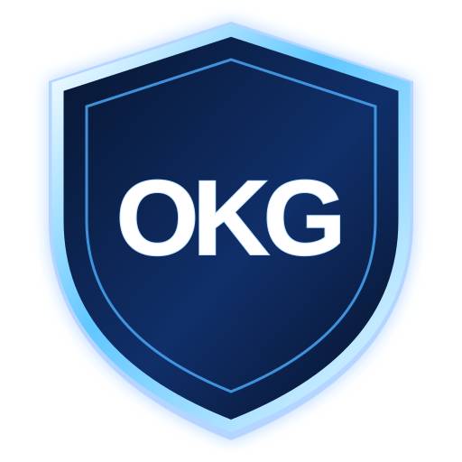

# OKG Administrative & Management

**The official OneKidGaming administration and community-management platform.**

OKG Administrative & Management provides Discord server owners and authorized staff with tools to configure, moderate, protect, and manage their communities from one connected dashboard.

## Platform features

- **Moderation & Automod** — configurable message filters, spam protection, and moderation actions.
- **Staff tools & cases** — moderation records, notes, and action tracking.
- **Server logs** — configurable event logging and audit visibility.
- **Community utilities** — tags, custom commands, reaction roles, slowmodes, and other server tools.
- **Support workflows** — native support tickets and transcript logging.
- **Web dashboard** — Discord sign-in, server configuration, access controls, and feature settings.
- **Documentation** — setup guides, configuration references, and module documentation.

## Official links

- [OKG Website](https://onekidgaming.blitz.cloud)
- [OKG Discord Server](https://discord.gg/nePR9dnuYm)
- [Open the dashboard](https://okg-zeppelin-dashboard.onekidgaming.blitz.cloud)
- [Contact OKG Support](mailto:support@onekidgaming.blitz.cloud)

## Usage documentation

- **[Self-hosting guide](docs/SELF_HOSTING.md)** — complete walkthrough from a fresh server to your own deployed bot, API, and dashboard.
- [Production deployment](docs/PRODUCTION.md)
- [Development setup](docs/DEVELOPMENT.md)

Open the platform's **Documentation** section for configuration, permissions, moderation, logging, and module guides.

## Development

This repository contains the OKG Administrative & Management application, including its Discord bot backend, API, and web dashboard. Internal package names and implementation identifiers are retained where required for compatibility with existing imports and deployments.

See [docs/DEVELOPMENT.md](docs/DEVELOPMENT.md) for development setup and [docs/PRODUCTION.md](docs/PRODUCTION.md) for production operations.

## OKG Moderation integration

The OKG Manager dashboard now contains a Moderation workspace. It proxies staff requests through the Manager API to the separate `OKG-Moderation-Management` service. The Manager frontend never receives the integration secret or Discord bot token.

Configure these server-side variables on the OKG Manager API:
- `MODERATION_API_URL`: base URL of the deployed OKG Moderation API, without a trailing slash.
- `MODERATION_API_SECRET`: a long random secret shared with `OKG_MANAGER_API_SECRET` on the moderation API.

On the moderation API, configure `OKG_MANAGER_API_SECRET` with the same value, plus the Discord bot token, guild ID, and current Moderator, Management, and Administrator role IDs. The moderation service verifies the acting user's current Discord roles before allowing staff actions. Do not put either integration secret or the Discord bot token in frontend environment variables.
