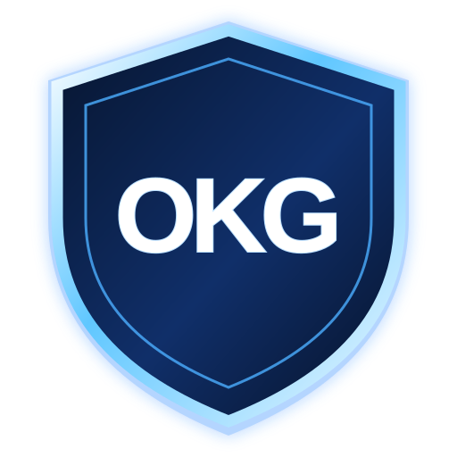

# OKG Administrative & Management

**The official OneKidGaming administration and community-management platform.**

OKG Administrative & Management provides Discord server owners and authorized staff with tools to configure, moderate, protect, and manage their communities from one connected dashboard.

## Platform features

- **Moderation & Automod** — configurable message filters, spam protection, and moderation actions.
- **Staff tools & cases** — moderation records, notes, and action tracking.
- **Server logs** — configurable event logging and audit visibility.
- **Community utilities** — tags, custom commands, reaction roles, slowmodes, and other server tools.
- **Support workflows** — native support tickets and transcript logging.
- **Web dashboard** — Discord sign-in, server configuration, access controls, and feature settings.
- **Documentation** — setup guides, configuration references, and module documentation.

## Official links

- [OKG Website](https://onekidgaming.blitz.cloud)
- [OKG Discord Server](https://discord.gg/nePR9dnuYm)
- [Open the dashboard](https://okg-zeppelin-dashboard.onekidgaming.blitz.cloud)
- [Contact OKG Support](mailto:support@onekidgaming.blitz.cloud)

## Usage documentation

Open the platform's **Documentation** section for configuration, permissions, moderation, logging, and module guides.

## Development

This repository contains the OKG Administrative & Management application, including its Discord bot backend, API, and web dashboard. Internal package names and implementation identifiers are retained where required for compatibility with existing imports and deployments.

See [docs/DEVELOPMENT.md](docs/DEVELOPMENT.md) for development setup and [docs/PRODUCTION.md](docs/PRODUCTION.md) for production operations.
